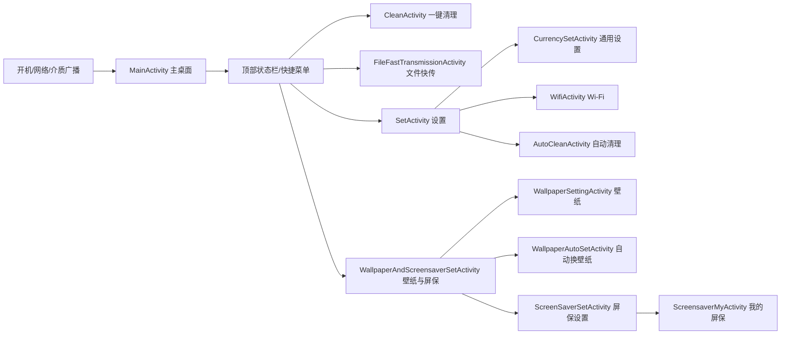

# 当贝桌面 4.1.7：页面与导航还原说明

## 1. 归档与工程边界

本项目由 APK 静态反编译生成，不是原始 Git 工程。

| 内容 | 路径 | 状态 |
|---|---|---|
| 可构建初版壳 | `app/` | 独立的横屏启动入口；不申请原 APK 的系统级权限 |
| 反编译 Java 源码 | `recovered/apk-decompile/sources/` | 已保留，3,758 个 `.java` 文件 |
| 反编译资源与原清单 | `recovered/apk-decompile/resources/` | 已保留，含 `res/`、`assets/`、`AndroidManifest.xml` |
| 还原路线图 | 本文件 | 基于清单、布局绑定和显式 `Intent` 调用整理 |

原应用包名为 `com.dangbei.tvlauncher`，最低 API 为 21（Android 5.0），target API 为 26（Android 8.0）。初版壳使用新包名 `com.penglauncher.recovered`，避免继承原 APK 的 `android.uid.system` 与平台签名要求。

当前恢复工程的最低 API 为 14（Android 4.0 / Ice Cream Sandwich）。为此已对首页时钟、状态栏与文件选择流程加入 Android 4.0 兼容实现；目标 SDK 保持 API 28。

## 2. 原始入口与全局流程

原始主入口为 `com.dangbei.launcher.ui.main.MainActivity`，清单声明了 `MAIN`、`HOME`、`LEANBACK_LAUNCHER` 和 `LAUNCHER`，固定横屏、`singleTask`。因此它既可从电视应用列表打开，也可以被选为系统 Home。

`MainActivity` 还负责隐私协议确认、存储权限请求、首页 ViewPager 初始化、应用安装/卸载监听、网络和 U 盘事件订阅，以及首页应用项/文件夹编辑对话框。

## 3. 页面清单

| 页面/组件 | 类与布局 | 主要功能 | 已识别的入口或下级页面 |
|---|---|---|---|
| 主桌面 | `ui/main/MainActivity` / `activity_main` | 应用网格、文件夹、推荐项、状态栏、壁纸背景 | Home 意图；应用/文件夹编辑对话框；顶部快捷功能 |
| 首页跳转层 | `ui/main/dialog/home/HomeDialogActivity`、`activity_home_jump` | Home 键拦截和桌面跳转处理 | 通过 `.Service.homeCatch` 与 `HomeKeyEventCatchService` 协作 |
| 顶部状态栏 | `ui/main/viewer/FitStatusBarView` / `layout_status_bar` | 时间、天气、网络、蓝牙、U 盘、消息与快捷入口 | 清理、文件快传、设置、壁纸/屏保 |
| 一键清理 | `ui/autoclean/CleanActivity` / `activity_clean` | 触发内存/后台应用清理并播放动画 | 顶部状态栏 |
| 自动清理 | `ui/autoclean/AutoCleanActivity` / `activity_autoclean` | 开关自动清理，配置不清理应用列表 | `SetActivity` |
| 设置总页 | `ui/set/SetActivity` / `activity_set_new` | Wi-Fi、通用设置、自动清理、系统设置、隐私、关于、版本切换 | 见本表对应页面 |
| 通用设置 | `ui/set/CurrencySetActivity` / `activity_currency_set_new` | 时间格式、启动/桌面行为、推荐、快捷开关、应用信息显示、密码 | 直达应用、密码设置 |
| 直达应用 | `ui/set/direct/DirectAppActivity` / `activity_direct_application` | 为快捷位置选择或配置应用 | `CurrencySetActivity` |
| 密码设置 | `ui/set/lock/PasswordSetActivity` / `activity_pass_word_set_new` | 设置密码；`PasswordDialog` 用于输入/重置 | `CurrencySetActivity`、首页编辑操作 |
| Wi-Fi | `ui/set/wifi/WifiActivity` / `activity_wifi_new` | 扫描网络、输入密码并连接；含 Wi-Fi 信息对话框 | `SetActivity` |
| 壁纸/屏保总页 | `ui/set/WallpaperAndScreensaverSetActivity` / `activity_wallpaper_and_screensaver` | 汇总壁纸、自动壁纸与屏保设置 | 壁纸、自动壁纸、屏保设置 |
| 壁纸设置 | `ui/wallpaper/main/WallpaperSettingActivity` / `activity_wallpaper_setting_new` | 浏览/选择壁纸、预览、从 U 盘或快传导入 | 壁纸预览、文件快传、微信快传设置 |
| 壁纸预览 | `ui/wallpaper/preview/PreviewWallpaperActivity` / `activity_preview_wallpaper_new` | 预览并应用壁纸 | `WallpaperSettingActivity` |
| 自动换壁纸 | `ui/wallpaper/autoset/WallpaperAutoSetActivity` / `wallpaper_aotu_set_new` | 配置自动切换规则 | `WallpaperAndScreensaverSetActivity` |
| 屏保设置 | `ui/screensaver/ScreensaverSetActivity` / `activity_screensaver_set_new` | 开关、时长及屏保来源 | 我的屏保 |
| 我的屏保 | `ui/screensaver/ScreensaverMyActivity` / `activity_screensaver_my_new` | 管理 U 盘/快传导入的屏保图片 | 文件快传、微信快传设置 |
| 屏保播放 | `ui/screensaver/ScreensaverActivity` / `activity_screensaver_new` | 全屏轮播屏保图片 | `ScreensaverService` 在满足条件时启动 |
| 文件快传 | `ui/set/file/FileFastTransmissionActivity` | 显示局域网地址与二维码，接收/管理上传文件 | 首页或壁纸/屏保页；类型参数为 `main`、`wallpaper`、`Screensaver` |
| 快传图片预览 | `ui/set/file/FileFastImagePreviewActivity` / `activity_file_fast_image_preview` | 预览通过快传收到的图片 | 文件快传流程 |
| 微信快传设置 | `ui/set/wx/WxFastTransmissionSetActivity` / `activity_wx_fast_transmission_set_new` | 绑定、解绑和配置微信图片传输 | 壁纸/屏保页面 |
| U 盘传图 | `ui/set/u/UTransmissionSetActivity` / `activity_u_fast_transmission_set_new` | 从 U 盘选择图片加入壁纸或屏保 | 壁纸/屏保流程 |
| 必备应用 | `ui/necessary/TvNecessaryActivity` / `dialog_tv_necessary` | 展示推荐分类并下载/安装应用 | 首页推荐项 |
| 文件管理器 | `yggdrasill/filemanager/*` | 浏览 U 盘、APK、音乐、视频与图片 | 外部 action `mimir.action.activity.file.manager.usb.info` 或相关入口 |
| 关于/隐私/WebView | `AboutActivity`、`AgreementActivity`、`WebViewActivity` | 版本、协议、网页内容展示 | 设置和首次启动 |
| 系统更新/消息 | `update/view/UpdateDialog`、`flames/ui/*` | 更新提示、推送消息列表/详情及下载 | 推送或应用更新检查 |

## 4. 已确认的显式跳转

以下为源码中可直接追踪的跳转，优先按这些边恢复导航：

1. `FitStatusBarView`、`TopScreenViewer` -> `CleanActivity`、`FileFastTransmissionActivity`、`SetActivity`、`WallpaperAndScreensaverSetActivity`。
2. `SetActivity` -> `WifiActivity`、`AutoCleanActivity`、`CurrencySetActivity`、`PermissionHintActivity`、`SwitchVersionActivity`、`AboutActivity`，或跳转宿主设备系统设置。
3. `CurrencySetActivity` -> `DirectAppActivity`、`PasswordSetActivity`。
4. `WallpaperAndScreensaverSetActivity` -> `WallpaperAutoSetActivity`、`WallpaperSettingActivity`、`ScreensaverSetActivity`。
5. `WallpaperFunctionFragment` -> `FileFastTransmissionActivity("wallpaper")`、`WxFastTransmissionSetActivity`。
6. `ScreensaverSetActivity` -> `ScreensaverMyActivity`；`ScreensaverMyActivity` -> `FileFastTransmissionActivity("Screensaver")`、`WxFastTransmissionSetActivity`。
7. `FileFastTransmissionActivity` 根据上传类型发送 `FastFileUploadEvent`；壁纸和屏保页面订阅该事件并把图片加入相应列表。

## 5. 后台组件与权限依赖

| 类型 | 组件 | 用途 | 还原建议 |
|---|---|---|---|
| Service | `HomeKeyEventCatchService` | Home 键流程处理 | 先以普通 Activity 导航替代，勿依赖系统键拦截 |
| Service | `AutoClearAppService` | 自动清理 | 改用受 Android 版本限制的应用级清理策略 |
| Service | `ScreensaverService` | 计时并显示屏保 | 可在页面恢复后以 `WorkManager`/前台服务重设计 |
| Service | 多个 `DownloadService` | 推荐/更新内容下载 | 统一迁移至一个受控下载实现 |
| Receiver | `BootReceiver`、`SystemEventReceiver` | 开机、网络、存储介质变化 | 仅保留当前 Android 允许的广播；动态注册其余事件 |
| Receiver | `PackageReceiver` | 应用安装、卸载、变更 | 用 `PackageManager` 刷新首页应用清单 |
| Provider | `OpenAbilityProvider` | 对外能力接口 | 在定义数据与权限模型后再恢复 |
| Provider | 多个 `FileProvider` | 安全共享文件 | 用 AndroidX `FileProvider` 重建路径规则 |

原 APK 请求了存储、安装包、Wi-Fi、位置、蓝牙、下载、覆盖层和后台任务等权限。其中 `GET_TASKS`、`RESTART_PACKAGES`、`CLEAR_APP_CACHE`、`MOUNT_UNMOUNT_FILESYSTEMS` 等在现代普通应用中不可用或效果受限，不能照搬。

## 6. 建议的分阶段还原顺序

1. 在 `app/` 建立新的首页：列出可启动应用、遥控器焦点与横屏布局；不要迁移系统 UID。
2. 迁移 `WallpaperAndScreensaverSetActivity` 及其三条子流程，先使用本地图片。
3. 迁移 Wi-Fi 只读状态展示和普通系统设置跳转；不要复制旧版 Wi-Fi 配置调用。
4. 迁移文件快传的 Web/二维码 UI，再单独设计上传服务及存储范围。
5. 最后评估下载、清理、开机、Home 键、系统设置等系统级功能的替代设计。

## 7. 已知限制

- JADX 报告 5 个反编译错误；其余代码虽已导出，也可能含不可读的混淆符号或反编译近似实现。
- 原工程缺少 Gradle 配置、依赖坐标、原始资源名称语义与服务端配置，不能直接编译。
- 原 APK 以 AOSP 测试平台证书签名，且声明 `android.uid.system`；初版工程故意不保留该配置，避免在普通设备上无法安装。

## 8. 当前可运行首页

当前恢复版已将首页改为电视启动器卡片网格，而不是按顺序展示所有应用：

- 首次启动会自动加入最多 8 个已安装、可启动应用。
- 点击卡片启动对应应用。
- 选中已有卡片后按遥控器菜单键可替换或移除入口。
- 点击 `+ 添加应用` 选择新入口。
- 首页固定为两行共 10 个桌面位置；已卸载应用的位置会显示为可重新选择的空卡片。
- 首页第二行按下方向键进入独立的“全部应用”页；全部应用页首行按上方向键回到首页。两个页面以垂直滑动动画切换。
- 首页背景使用原 APK 的 `res/drawable-1920x1080/bg_launcher_default_new.webp`，运行工程内的副本为 `app/src/main/res/drawable-nodpi/bg_launcher_default_new.webp`。
- 当前设置功能保留“Wi-Fi”（跳转系统 Wi-Fi 设置）、“首页壁纸”（从本地选择图片）和“关于 PENG 桌面”；通用设置、自动清理、快传、屏保及其他原 APK 功能均已从运行入口移除。
